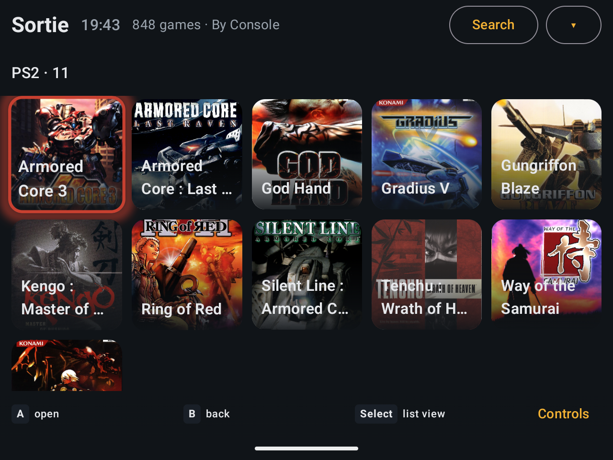
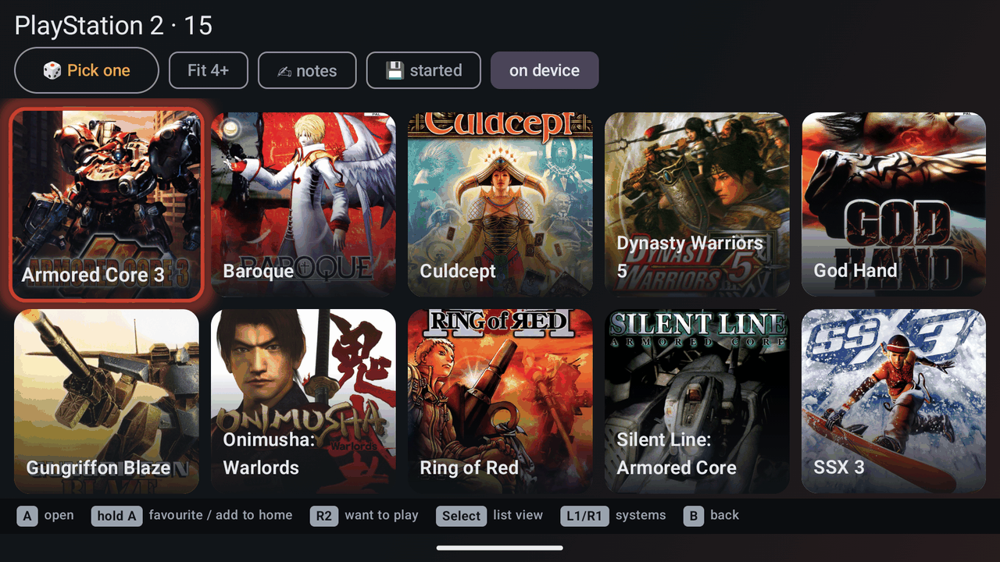
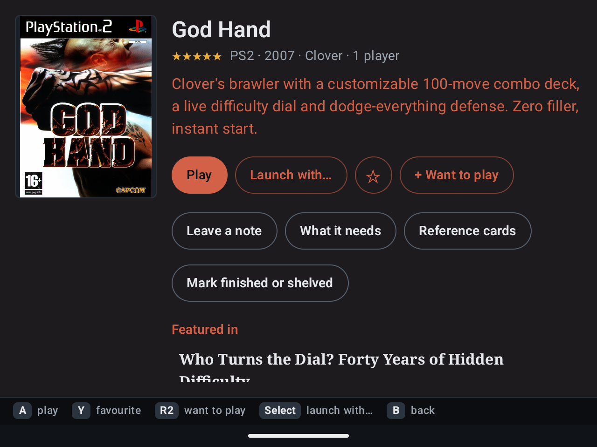
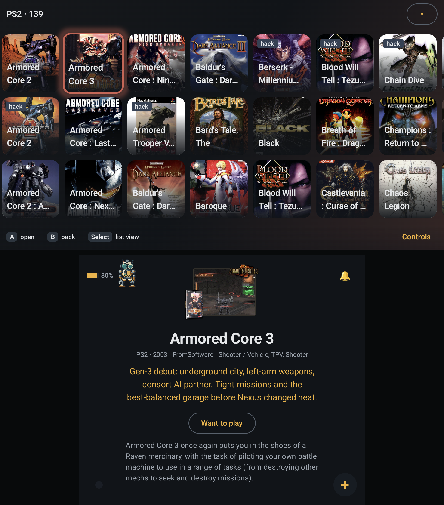
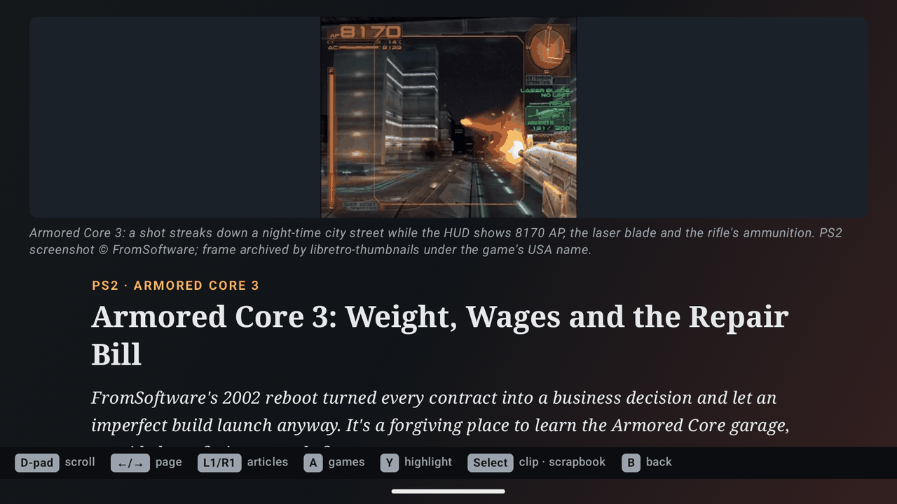

**An offline, controller-first game launcher for Android handhelds.** Sortie lists the games already on your device,
starts them in the emulators you've installed, and keeps notes, backlog and play history beside them. It has no
internet permission and never downloads games, BIOS files, emulators or artwork.

> [!IMPORTANT]
> **Sortie is built in collaboration with AI.** The code, this documentation and the optional Field Notes magazine are
> written with AI assistance. If that's a dealbreaker, better to know now than after setup.

**Beta. No APK has been published yet**; see [Installing](#installing).



<sub>Real app UI with illustrative demo entries, not a launch-tested library. Artwork and magazines were configured for
these emulator captures; a fresh library starts without artwork.
[Capture notes and image credits](docs/screenshots/readme/PROVENANCE.md).</sub>

**New to emulation or sideloading?** Start with the [Getting started guide](docs/GETTING_STARTED.md). No terminal,
computer or prior experience needed.

## Is it for you?

**Yes, if** you have an Android 11+ handheld and your own game files, use (or will set up) emulators such as RetroArch
or PPSSPP, and want a controller-driven front end with a backlog, notes and play history, but no accounts, store or sync.

**No, if** you want an app that finds games, BIOS files, emulators or cover art for you; need something to install
today; or need confirmed support for your exact device and emulators. Only a few combinations are tested
([known limitations](docs/RELEASE.md#known-limitations)).

Built first for the AYN Thor, a dual-screen Android 13 handheld, where the second screen becomes a companion panel. It
also runs on single-screen handhelds and has been used on the AYANEO Pocket DMG.

## A look around

### Find something to play



**L1/R1** cycle Home's sort: A–Z, game count, generation, or **Custom**, your own layout of pinned systems, games,
apps, smart folders, **Favourites**, **Want to play** and a **Continue** tile. Systems open as a list or grid with
filters and **Pick one** for a random game. Search needs no typing: pick a system, tag or genre.

**R2** adds a game to *Want to play*. Hold **A** to favourite or pin it. On Home, hold **R1** on a system for a random
game from it.

### Keep track of a game



**Play** uses the system's emulator; **Launch with…** picks another for that game only. Every session is recorded, so
play time adds up on the game page and in a weekly **Journal** of dated notes and pictures.

Mark games **Finished** or **Shelved** with a short verdict. Keep **reference cards**: controls, a move list, a photo of
a map. It all stays on the device; **Export backup** in Settings saves the text to one file.

### Use the second screen



The second screen follows what you're doing. Browsing: the focused game's art, description and your notes. Playing: a
timer, your *Where was I?* reminder, control notes and reference cards, all by touch so the controller stays in the
game. It also holds a five-slot app dock and a launcher.

### Read about games



**Field Notes** is an optional offline games magazine, published separately in
[sortie-zines](https://github.com/sortie-launcher/sortie-zines). Sortie remembers your place, shows which featured games
are on your device and links to their pages. Highlight a passage, add a note, keep it in your scrapbook. Issues aren't
included by default: copy an issue folder to the device or use a build that bundles them.

### Set up on the handheld


**Library setup** adds systems from a built-in list or your own, points them at your game folders and puts installed
emulators in fallback order. Each system says what its emulators need before the first game. No JSON, computer or
terminal; the [Getting started guide](docs/GETTING_STARTED.md) walks through it.

## What you need

**Required**

- **Android 11 or newer.**
- **Your own game files**, on internal storage or a memory card. Sortie supplies none.
- **Emulators, installed and set up.** First-run setup, RetroArch cores and BIOS files happen inside each emulator;
  Sortie only starts what's already installed.
- **All files access**, so Sortie can read your game folders and keep its settings. It explains and opens the switch
  on first start.

A controller is recommended; touch works too.

**Optional, one feature each**

- **A second screen**: the companion panel. Single-screen devices get a single-screen layout.
- **Sortie as default Home app**: Home returns to Sortie (or its switcher). Switch back any time in Android Settings.
- **[Shizuku](https://shizuku.rikka.app/)**: the switcher, which shows what's running and moves apps between screens,
  plus the companion's notification bell. With Sortie as Home, the Home key opens the switcher.
- **Display over other apps**: the switcher appears over a running game instead of as a normal Sortie screen.
- **Radial keyboard**: a controller-friendly Android keyboard for any text field.
- **A computer**: cover art, descriptions, curator notes, smart folders and system logos. See
  [Going further](#going-further).

Browsing, setup and launching need none of these. The guide has a
[feature-by-feature prerequisite table](docs/GETTING_STARTED.md#optional-features-and-what-they-need).

## How Sortie thinks

- **Offline by construction.** No internet permission. Nothing is scraped, synced, update-checked or reported.
- **Your games, your emulators.** You supply games, emulators, BIOS files and artwork. Sortie organises and starts
  them; it knows an emulator opened, not that the game runs.
- **Your library stays yours.** Removing a system never deletes games, saves or notes. **Export backup** saves
  preferences, notes, shelves and play history; some state, such as magazine reading positions and Android shortcut
  pins, is not included ([updating safely](docs/GETTING_STARTED.md#updating-safely)).
- **The handheld is enough.** Setup and play happen on the device, with games listed by cleaned-up file name. Files
  prepared on a computer add art and descriptions without replacing on-device setup.
- **Integration is opt-in.** Use Sortie as an ordinary app or as your Home screen. Home role, Shizuku, overlay and
  keyboard are separate choices.
- **It claims only what was tested.** Each emulator preset says whether it was tried on a device or only checked
  against the emulator's source.

## Installing

No APK yet. Signed beta APKs are planned for [GitHub releases](https://github.com/sortie-launcher/sortie/releases);
there is no store listing, account or auto-updater. Watch the repository's releases to hear when one lands.

[Actions](https://github.com/sortie-launcher/sortie/actions/workflows/build.yml) artifacts are magazine-free test
builds: a debug-signed APK and an unsigned release APK, which Android won't install. Neither is for daily use, and a
debug-signed install can't be updated in place to a release. **Never uninstall a daily install to get around a
signature mismatch**; ask for an APK signed with the right key.

With an APK in hand, the guide covers [installing it](docs/GETTING_STARTED.md#install-sortie),
[setting up an emulator](docs/GETTING_STARTED.md#set-up-and-test-one-emulator),
[adding your first system](docs/GETTING_STARTED.md#add-your-first-system) and
[optional features](docs/GETTING_STARTED.md#optional-features-and-what-they-need). The full
[manual](app/src/main/assets/MANUAL.md) is also in the app: the book button beside Settings on Home.

## Going further

A library prepared on a computer adds what the handheld can't produce:

- cover art and descriptions from an [ES-DE](https://es-de.org/) scrape;
- a guide file of curator ratings, one-line hooks, tags and control notes ([format](docs/formats/guide.md));
- rule-based smart folders ([format](docs/formats/folders.md)), system logos and custom launch profiles.

The [file formats](docs/formats/) are documented, and [examples/card/](examples/card/) is a complete minimal card. Script
any desktop pipeline you like; nothing here depends on one. On-device Library setup changes only what you edit, keeps
the rest, and won't save over files it can't read or that changed since it read them, so either side can edit a
prepared library.

Reference:

- [Manual](app/src/main/assets/MANUAL.md): every screen and control, as bundled in the app
- [docs/formats/](docs/formats/): configuration and content formats, including magazine packs
- [docs/LAUNCHERS.md](docs/LAUNCHERS.md): emulator launch intents and what was verified
- [docs/COCOON_IMPORT.md](docs/COCOON_IMPORT.md): moving a Cocoon library into Sortie, and what it never changes
- [docs/RELEASE.md](docs/RELEASE.md): beta status, evidence, known limitations, signing and magazine content
- [docs/SPEC.md](docs/SPEC.md): behaviour, controller grammar and implementation notes for contributors
- [docs/NOW_PLAYING.md](docs/NOW_PLAYING.md): scope note for RetroArch companion controls (not built)
- [CHANGELOG.md](CHANGELOG.md)

## Building from source

JDK 17 and Android SDK platform 35. Copy `local.properties.example` to `local.properties` and set `sdk.dir`.

```
tools/build.sh        # ktlintCheck, debug + release unit tests, debug APK and an unsigned release APK (no formatting)
tools/dev.sh install  # adb install -r of the debug APK + grants; SORTIE_HOME=1 also restores the Home role
tools/release.sh      # signed release APK + SHA-256 in dist/, using the key from tools/init-release-key.sh
```

Plain `./gradlew ktlintCheck testDebugUnitTest assembleDebug` works too. The helpers use `java` from `PATH`, falling
back to a distrobox container named `ubuntu` only when there is none. `tools/build.sh` and `tools/release.sh` pass extra
arguments to Gradle; `tools/dev.sh` reads `SORTIE_SERIAL`, `SORTIE_TOP_DISPLAY` and `SORTIE_BOTTOM_DISPLAY`. Debug
builds accept `am start … --es open <route>` and `--es launch '<system>/<file>'`. Signing, versions and the
debug/release signature mismatch: [docs/RELEASE.md](docs/RELEASE.md).

**Magazines are opt-in.** Normal builds contain no issues and never download any. To bundle Field Notes, clone
[sortie-zines](https://github.com/sortie-launcher/sortie-zines) alongside the app and pass its `issues/` folder:

```
git clone https://github.com/sortie-launcher/sortie-zines.git ../sortie-zines
tools/build.sh -PsortieMagazinesDir=../sortie-zines/issues
```

The build checks the content against the catalog digest pinned in `app/magazines.lock` and stages it only under
`app/build/`. Publishing and update behaviour:
[docs/RELEASE.md](docs/RELEASE.md#magazine-content-separate-repository).

## Branding

The amber Split-S is Sortie's mark: amber `#F2B134` on ink `#101418`. Assets, export commands and the GitHub
social-preview procedure are in [branding/](branding/README.md).

## Licence

Code and original text are MIT-licensed ([LICENSE](LICENSE)). Third-party material is not:

- **Magazines** live in the separate `sortie-zines` repository and enter an APK only through `-PsortieMagazinesDir`.
  Their screenshots, manual scans, box art and quotations belong to their rights holders; each issue carries a rights
  notice and credits every picture in `sources.json`.
- **System logos**, for example rendered from the CC-BY-NC-SA [slate-es-de](https://gitlab.com/es-de/themes/slate-es-de)
  theme, aren't in this repository; they live only on a user's card.
- **Documentation screenshots** include third-party game art and descriptions, excluded from MIT.
  [Capture notes and credits](docs/screenshots/readme/PROVENANCE.md) separate illustrative entries from the tested
  homebrew. Game-art packs and gamelists are not distributed with the source.
