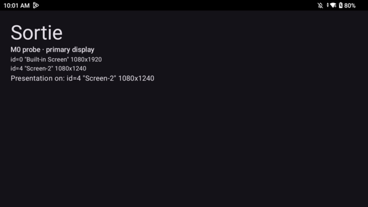

# Sortie

An offline, controller-first game launcher for Android handhelds — built for a library that is curated on a desktop and
synced to the device. Sortie renders what your pipeline produces (ES-DE gamelists and artwork, hand-written notes and taste
scores) and launches games through launch profiles you define. It never scrapes, has no network permission, and ships no
emulator database.

Primary target: the AYN Thor (Android 13, dual screen — the bottom screen becomes a companion panel, dock and app switcher).
Also runs on single-screen handhelds (tested on the AYANEO Pocket DMG).



## What it does

- Home of systems and smart folders in five sorts (alphabetical, game count, generation, custom layout, by console); a
  **Continue** tile for the last game played; grids that scroll sideways or down, 2–7 tiles per row.
- Lists with filters (fit ★★★★+, hand-written notes, started/has a save, on device), search, a random pick.
- Game pages with cover, hook, description, play stats, control notes; **Launch with…** picks a launcher per game; a default
  launcher per system in Settings; falls back through the manifest order to "Open with…".
- Smart folders from JSON rules (tags, fit, play time, days since played, recent-tags similarity …).
- Installed apps and launcher shortcuts as first-class items (favourite them, add them to home, pin them to the dock).
- Dual screen: the companion shows the focused game's art and notes while you browse, what's playing while you play, a
  5-slot dock and a touch launcher; Home key opens a switcher that moves running apps between screens (needs Shizuku).
- Zero idle cost: nothing animates, polls or ticks while you're not pressing anything (one recomposition a minute for the clock).
- Play log on the card (`playlog.jsonl`), favourites and preferences in `user.json` — plain files you own.

A full user manual is bundled: Settings → Help → Manual (`app/src/main/assets/MANUAL.md`).

## How it fits together

Sortie reads a `sortie/` directory at the root of your card (or primary storage):

| File | Who writes it | What |
|---|---|---|
| `device.json` | desktop | root path, screen layout, save/BIOS dirs |
| `systems.json` | desktop | systems: folders, extensions, gamelist/media paths, launch profiles, colour |
| `launchers.json` | desktop | launch profiles: package, activity, action, extras, display |
| `folders.json` | desktop | smart folders (rules) and manual folders |
| `guide.json` | desktop | per-game fit, hook, flags, tags, control notes |
| `logos/` | desktop | optional system logos for the home tiles |
| `user.json`, `playlog.jsonl` | device | favourites, preferences, play sessions |

Formats are documented in [docs/formats/](docs/formats/); [examples/card/](examples/card/) is a complete minimal card.
The desktop side (generating manifests from your ROM tree, scraping with ES-DE, rendering logos) is yours to script — Sortie
only needs the files. [docs/LAUNCHERS.md](docs/LAUNCHERS.md) lists emulator intents that are known to work.

## Requirements

- Android 11+ (API 30). Grant **All files access** on first run (Sortie restarts once to bind to the card).
- Optional: [Shizuku](https://shizuku.rikka.app/) for the app switcher, screen moves and the notification bell; "Draw over
  other apps" for the overlay switcher. Everything else works without them.
- Set Sortie as the default Home app for the Home-key switcher and the second-screen companion.

## Building

JDK 17 and the Android SDK (platform 35). Copy `local.properties.example` to `local.properties`, point `sdk.dir` at your SDK:

```
tools/build.sh        # ktlintFormat, assembleDebug, ktlintCheck, unit tests (one Gradle invocation)
tools/dev.sh install  # adb install + grants; SORTIE_HOME=1 also restores the Home role
```

`tools/build.sh` runs Gradle through `distrobox enter ubuntu` when the host has no `java`; with a JDK on the path it runs
Gradle directly. Debug builds accept `am start … --es open <route>` and `--es launch '<system>/<file>'` for scripting.

## Docs

- [docs/SPEC.md](docs/SPEC.md) — behaviour and controller grammar
- [docs/HANDOFF.md](docs/HANDOFF.md) — architecture, tooling, open items (for contributors)
- [CHANGELOG.md](CHANGELOG.md)

## Licence

MIT. See [LICENSE](LICENSE). System logos rendered by `gen_logos.py` come from the
[slate-es-de](https://gitlab.com/es-de/themes/slate-es-de) theme (CC-BY-NC-SA) and are not part of this repository.
