# Getting started with Sortie

This guide assumes you have never set up game emulation on Android. It takes you from nothing to one game started from
Sortie, then explains what else Sortie can do and what each extra needs. You do not need a computer, a terminal, an
account, an AI service or any other launcher to follow it.

**The short version:**

1. [Get a correctly signed Sortie APK](#install-sortie) and install it (Android 11 or newer).
2. [Install one emulator and check that it runs a game by itself](#set-up-and-test-one-emulator).
3. [Allow *All files access*](#first-start-all-files-access) when Sortie asks.
4. [Add one system in Library setup](#add-your-first-system): what kind of games, which folder, which emulator.
   **Coming from Cocoon?** [Import your Cocoon library](#coming-from-cocoon) instead.
5. [Start a game, then come back](#launch-play-and-come-back).

Everything after that is optional. The [full manual](../app/src/main/assets/MANUAL.md) is also built into the app: the
book button beside **Settings** on Home, or **Settings → Manual**.

The walkthrough pictures come from an Android 13 emulator. Open an image to see it full-size; Android's own Settings
screens vary by device. [Capture details and image credits](screenshots/readme/PROVENANCE.md).

## Words you'll meet

| Word | Meaning |
|---|---|
| **Launcher** | An app for finding and starting other apps or games. Your device's home screen is a launcher. **Sortie is a launcher.** It does not play games itself. |
| **Emulator** | An app that imitates a console so its games run on Android, such as RetroArch, PPSSPP or DuckStation. Sortie asks an installed emulator to open a game file. |
| **Game file (ROM, ISO)** | A copy of a game stored as a file, for example `.gba`, `.iso` or `.chd`. "ROM" usually means cartridge games; disc games are often called ISOs or disc images. |
| **BIOS / firmware** | Startup software from the original console that some emulators require (for example PlayStation consoles). It is copyrighted and console-specific. |
| **Core** | RetroArch's name for an emulator module. RetroArch can run many cores; install the one your game needs inside RetroArch. |
| **System** | In Sortie, one kind of game (such as *Game Boy Color*), the folders holding those games, and the emulators that start them. |
| **APK** | An Android app installation file. |
| **Sideloading** | Installing an APK yourself instead of through an app store. |
| **Signature / signer** | Every APK is signed with its maker's key. Android installs an update only if it has the same signature as the installed app. |
| **Special app access** | Android permissions you switch on in Settings instead of answering a pop-up, such as *All files access*, *Display over other apps* or the default Home app. |
| **Cocoon** | Another Android launcher for handhelds. Sortie can [import a Cocoon library](#coming-from-cocoon); you don't need Cocoon otherwise. |
| **Shizuku** | A separate, optional app that lets apps such as Sortie run a small set of system commands. Sortie uses it only for its app switcher (listing, moving and closing running apps) and the companion's notification bell. See [optional features](#optional-features-and-what-they-need). |

## What you need

**Required for the basics (browse, set up, launch):**

- An Android device running **Android 11 or newer**. Sortie is designed for handhelds with a controller and also works by
  touch. It has been tested on a few devices only; see [RELEASE.md](RELEASE.md#beta-01).
- **Sortie itself**, installed from a correctly signed APK (see [Install Sortie](#install-sortie)).
- **At least one emulator** installed separately and set up inside that emulator.
- **Game files you are legally allowed to use**, copied onto the device: internal storage, a memory card or USB storage
  that Android can read. Sortie never downloads, sells or supplies games, BIOS files or emulators.
- **BIOS files**, only if the emulator for that system needs them, installed the way that emulator says.
- **All files access** for Sortie, granted once on first start.

**Not required for the basics:** a computer, a terminal or ADB, Cocoon, ES-DE or any other launcher, an account, an
internet connection for Sortie, an AI assistant, Shizuku, making Sortie your Home screen, a dual screen, a memory card,
artwork, or any JSON editing. (Adding artwork later does need one of the routes under
[Want box art?](#want-box-art) below.)

Sortie has no internet permission. It cannot download anything, including updates, artwork or descriptions. Initial
downloads of APKs, emulators or RetroArch cores may need a connection in those other apps; Sortie itself never does.

> **About game files.** Use games you own and have the right to copy, or games their authors distribute for free. Laws
> differ by country. This guide does not explain how to obtain commercial games or BIOS files.

## Install Sortie

### Getting the APK

Download the APK attached to the newest beta on the [Releases page](https://github.com/sortie-launcher/sortie/releases).
These automated beta releases are marked Latest, include the Field Notes magazines and use the permanent release signing key. Each includes a
`.sha256` checksum file you can compare with a checksum app. A beta passing automated checks is not a guarantee that every
emulator or device has been tested.

Do not use a random re-upload. Also be aware:

- The **GitHub Actions build artifacts** are test builds: one is signed with a throwaway debug key, the other is unsigned
  (Android cannot install it). They include that build's magazine snapshot but are not the signed release download. A debug build
  cannot later be updated by an official signed release without uninstalling first, so do not use one as your everyday copy.
- Building Sortie from source is possible ([README](../README.md)) but is not needed to use it. A self-signed copy uses
  your key, not the maintainer's, so it has a separate update path.

### Installing (sideloading)

1. Download the release APK on the device, or copy it there from your computer.
2. Open it from your Files app or browser.
3. Android asks whether that app may *install unknown apps*. Allow it only for the trusted app you are using to open the
   APK, then go back and choose **Install**. Read any Play Protect warning rather than bypassing it automatically; if
   Android reports that the APK is harmful, stop and check with the maintainer.
4. When it is installed, open **Sortie** from your app drawer. Installing does not replace your current Home screen.

### Updating safely

- To update, open the **newer APK from the official Releases page** and choose **Update**. Android keeps Sortie's data.
- If Android refuses ("App not installed", "package conflicts with an existing package" or similar), **stop**. That
  usually means the new APK is signed by someone else, or is a debug build. **Do not uninstall Sortie to get past it.**
  Ask the person who sent the APK for a correctly signed one.
- Uninstalling deletes things only the app keeps: play-time statistics not yet exported, magazine reading positions, the
  remembered library location, Android permissions, the Home role and ownership of pinned Android shortcuts. If you ever
  really must uninstall, first use **Settings → Backup and restore → Export backup…** and copy the whole `sortie` folder
  shown in **Library setup → Where these settings live**. These copies do **not** restore reading positions, permissions,
  the Home role or Android shortcut pins. See the manual's *Backup and restore* section.

## Set up and test one emulator

Sortie only starts emulators. If an emulator cannot run a game on its own, Sortie cannot fix that. So test the emulator
first, without Sortie.

1. **Pick the system you want to start with.** For a first try, choose a simple cartridge system such as Game Boy or
   Game Boy Color: small files and no BIOS needed.
2. **Install its emulator** from the emulator's official website or app store. For the Game Boy family, Sortie's
   presets use **RetroArch**.
3. **Open the emulator and finish its own first-run setup.** Allow the storage access it asks for.
4. **RetroArch only: download the core.** In recent versions this is in RetroArch's main menu under **Online Updater →
   Core Downloader** (for Game Boy / Game Boy Color, the *Gambatte* core). Menu names can differ between versions and
   stores. Sortie can see whether RetroArch is installed, but never whether a core is.
5. **Put one game file in a folder of its own**, for example `Games/gbc` on internal storage, using your Files app (most
   Files apps can make a new folder). Avoid `Android/data` and `Android/obb`: Android does not let Sortie read them.
6. **Open that game inside the emulator.** In RetroArch: **Load Core** → *Gambatte*, then **Load Content** → your file.
   If it plays, the emulator is ready.
7. **Quit the emulator properly.** In RetroArch use **Quit RetroArch** from its main menu, so that it starts cleanly when
   Sortie opens it later.

> **No games yet?** One legal example: [uCity](https://hh.gbdev.io/game/ucity), a free, open-source city-building game
> for the Game Boy Color by AntonioND (GPL-3.0-or-later; its graphics and music are CC BY-SA 4.0), offered as a
> **Download ROM** link on the Homebrew Hub page. It is a single `.gbc` file. Our onboarding check launched it through
> Sortie into RetroArch 1.22.2/Gambatte on an Android 13 emulator, with the core already installed. That is a launch check,
> not a performance promise for every handheld. Homebrew Hub lists many other freely distributed homebrew games.

If you plan to use systems such as PlayStation or PlayStation 2, set up their BIOS inside that emulator as its own
documentation explains. Sortie does not configure emulators.

## First start: All files access

Open Sortie. The first screen says **Let Sortie see your games**.

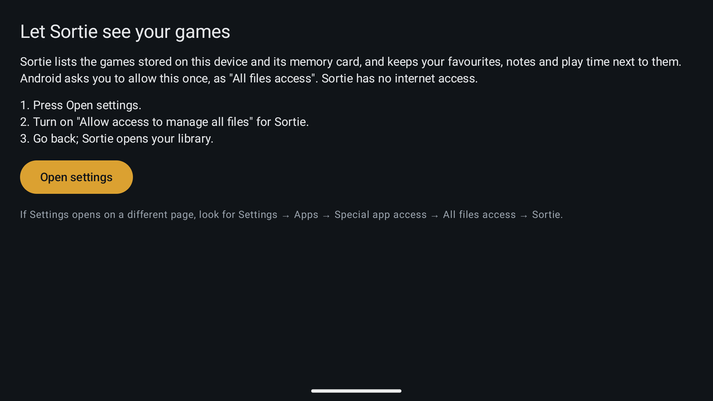

1. Press **Open settings**. Android's page for Sortie opens.
2. Turn on **Allow access to manage all files** (the wording can differ slightly by device).
3. Go back. Sortie opens.

Sortie needs this to read your game folders and to keep its settings and your notes in a `sortie` folder. It is the only
permission the basics need. If Android opens a different page, go to **Settings → Apps → Special app access → All files
access → Sortie** yourself. Sortie checks again every time you return to it; if you ever turn the switch off, this screen
comes back.

**Checkpoint:** you see Sortie's Home screen with **Set up your library** and a **Set up library** button. If you already
have a library prepared on a computer, you might see systems straight away instead; skip to
[Launch, play and come back](#launch-play-and-come-back). If your games are already set up in Cocoon, go to
[Coming from Cocoon](#coming-from-cocoon).

## Coming from Cocoon

If your games are already set up in the Cocoon launcher, Sortie can import that library instead of you adding each
system by hand. Cocoon's files are only read: nothing in its folder is created, changed or deleted, and Cocoon itself is
not started, stopped or reconfigured. Cocoon doesn't need to be running, and no root or computer is needed.

**What comes over**

| From Cocoon | In Sortie | Needs a Cocoon backup |
|---|---|---|
| Platforms with games on this device | Systems, with the game folders Sortie found | No |
| Each platform's emulator | The system's emulator (see the caution in step 4) | No |
| Favourites and hidden games | Favourites, and hidden games (kept out of folders and shelves), added to any you have | No |
| Downloaded box art, logos and gameplay screenshots | Copies in each system's media folder, only where Sortie has no art | No |
| Your own folders | Folders listing the same games | Yes |
| Play sessions | Play history with the real dates and times | Yes |
| Per-game emulator choices | Per-game emulators, only where you haven't set one | Yes |

Not imported: lifetime play counts and play time (shown in the preview only), themes, wallpapers, widgets, grid
placement, custom game names and per-game "launch on external display". DroidDeck pins belong to the launcher that made
them; the result lists the DroidDeck games to pin again from DroidDeck.

**Before you start**

- **Make a Cocoon backup** in Cocoon → Settings if you want your own folders, play history and per-game emulators. Only a
  backup carries them, and anything you do in Cocoon after making it is not included.
- **Keep Cocoon and its folder** until you've checked the result. Sortie copies artwork but needs Cocoon's files to run
  the import again.
- **There is no complete undo.** Preferences and library settings can be put back (see *What undo can and can't do*
  below), but imported play sessions and copied artwork stay. To keep those out, turn off **Add *N* play sessions** and
  **Copy *N* artwork files** in the preview. Copying the `sortie` folder first (its location is under **Library setup →
  Where these settings live**) lets you put your library settings back.

**Import**

1. **Settings → Import from Cocoon…**
2. **Check Cocoon's folder.** Sortie looks for folders holding a Cocoon library on every storage it can read and selects
   the one it finds (or the one used last time); the **Cocoon folder** section further down shows it and lists any
   others. If yours isn't found, type its path there or pick it with the file browser. A folder without a Cocoon library
   is refused and nothing changes.
3. **Choose a backup, or continue without one.** Backups in Cocoon's folder are listed newest first. **Another backup…**
   accepts one anywhere on the device, for example a copy in Download or on a memory card.

   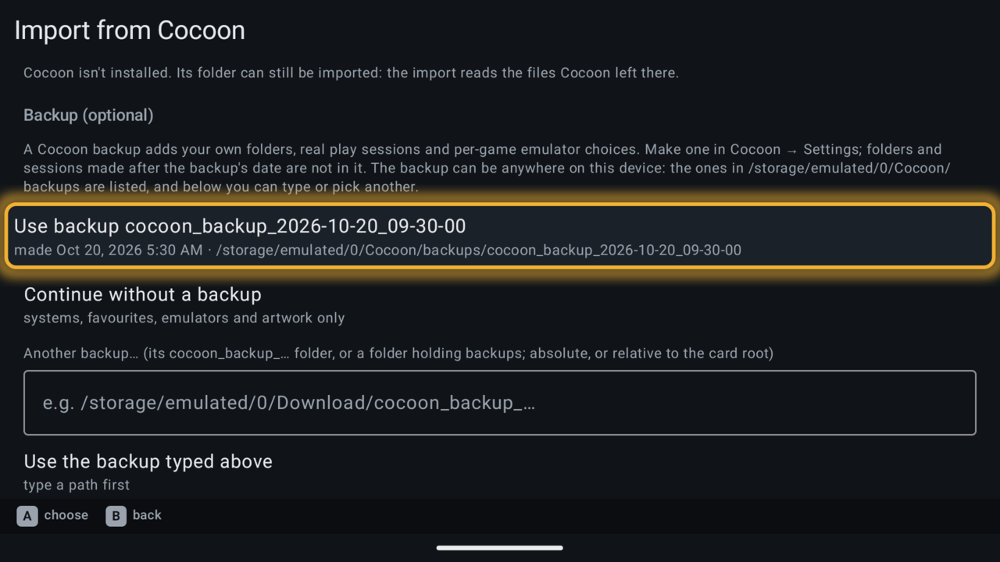

4. **Read the preview.** Nothing has been written yet, and **Cancel** changes nothing. It shows how many games matched
   files on this device, a switch for each category, and below them the artwork against free space, the systems to add
   with their folders and emulator (and whether that emulator is installed), and the games that were not found or were
   ambiguous. Counts distinguish new entries from those already here; repeat imports do not promise to add them again.

   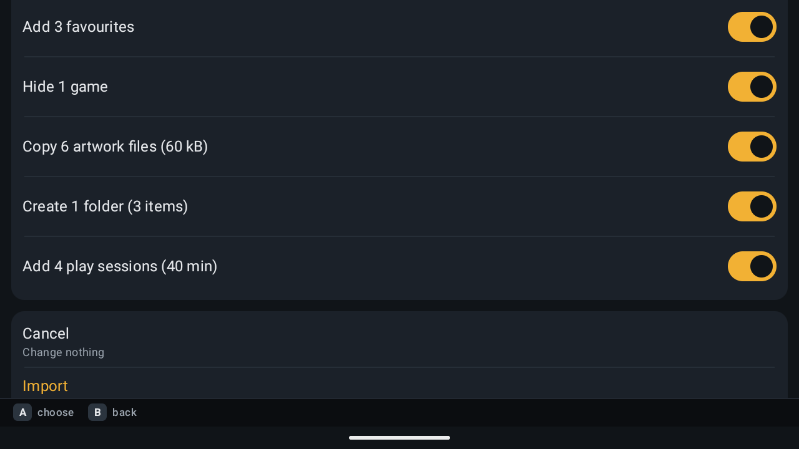

   These walkthrough captures predate the default-preservation and count fixes: the current preview has no switch to
   replace existing systems' emulators, and lists already-present entries separately from additions.

   Existing systems keep their emulator defaults. New systems put Cocoon's emulator first; if its RetroArch package is
   missing and an equivalent build is installed, the preview identifies the substitution. You still need its core and BIOS.
   Check these switches before importing:
   - **Hide *N* games.** Hidden games stay in their system's list but drop out of folders and shelves, and Sortie has no
     button to unhide them yet ([Troubleshooting](#troubleshooting)). Turn it off if you aren't sure.
   - **Copy *N* artwork files.** Import is not offered while the artwork doesn't fit the free space shown; turn the copy
     off or free some space. On a card set up for ES-DE, artwork goes into that system's existing ES-DE media folder.

   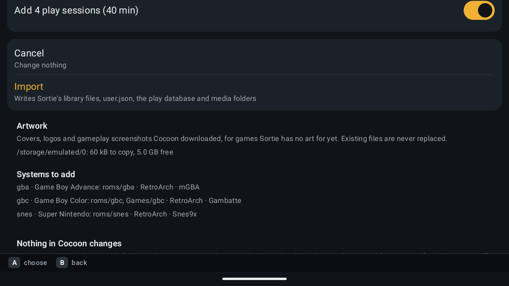

5. **Choose Import.** A broken library configuration must be repaired first. If library settings changed since the preview,
   Sortie asks you to review a fresh plan before anything is written. Otherwise it saves a safety copy of your preferences
   and play history to `sortie/backups/pre-cocoon-import-<date>.json`; if it can't, nothing changes. It then adds systems,
   re-indexes, adds missing per-game profiles, saves favourites, hidden games and per-game choices, adds sessions and folders, and copies artwork last. You can
   leave the screen while Sortie keeps running. Only the artwork copy can be stopped (**Stop copying artwork**); files
   already copied stay.
6. **Read the result.** It lists what was added, where the safety copy is, which DroidDeck games to pin again, and what
   stays only in Cocoon.

   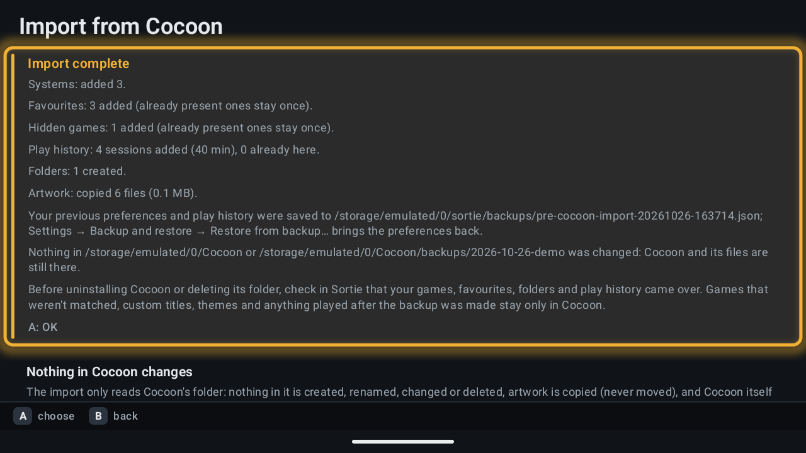

**Checkpoint:** your Cocoon systems are on Home with their artwork. Press **L1/R1** to the **Custom** sort to see
**Continue**, **Favourites** and your imported folders; **Alphabetical**, **Game count** and **Generation** show systems
only.

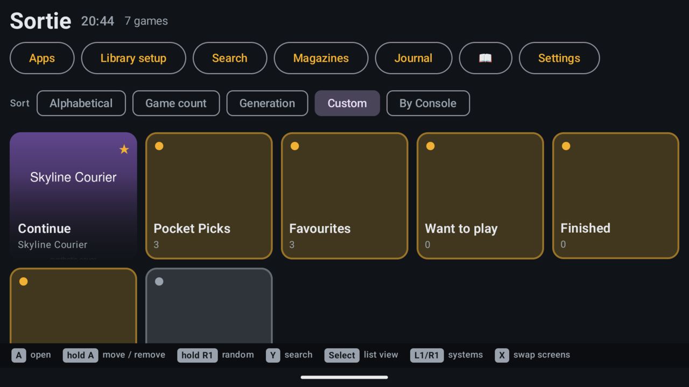

Then open **Library setup** and check each new system: install any emulator marked *not installed*, and if a system
indexed no games, compare its **File types** with your files (for example `.7z` or `.zip`) and add the missing ending.
Finally [start one game per system](#launch-play-and-come-back): the emulators' own settings, cores and BIOS files are
untouched, but only playing proves a game runs. The pictures above come from an Android 13 emulator with an invented
library ([capture details](screenshots/cocoon/PROVENANCE.md)).

**Running it again is safe.** It adds nothing twice and picks up artwork a stopped copy left behind. If Android closes
Sortie during the import, open it and run the import again.

**What undo can and can't do.** There is no complete rollback:

- **Preferences:** restoring the safety copy (**Settings → Backup and restore**) brings back favourites, hidden games and
  emulator choices from before the import.
- **Library settings:** systems, folders and launch profiles added by the import stay. Remove them in Library setup, or put
  back a copy of the `sortie` folder made before importing and use **Library setup → Re-index every system**.
- **Play sessions stay.** They live in Sortie's private database, not the `sortie` folder, and restoring a backup only adds
  sessions, never removes them.
- **Copied artwork stays** in each system's media folder, which on a card set up for ES-DE is outside the `sortie` folder.
  Restoring files or a backup doesn't remove it.

**Before uninstalling Cocoon**, check in Sortie that your games, favourites, folders and play history came over. Games
that weren't found or were ambiguous, custom names, themes, skipped artwork and anything played after the backup stay
only in Cocoon. To make Sortie the Home screen instead of Cocoon, see
[Finding your way around](#finding-your-way-around).

The full reference, including how folders and emulators are matched: [Import from Cocoon](COCOON_IMPORT.md).

## Add your first system

Press **Set up library** (later the button reads **Library setup** on Home, or use **Settings → Library and emulators**).
The Library setup screen lists your systems; it starts empty.

1. **Add a system…** shows a list of common systems. Under each name Sortie says what it found on your device, for
   example *Emulator app installed: RetroArch · cores are set up separately in RetroArch*, or *Not installed yet: …*.
   Choose **Game Boy Color** (or your system). If yours is missing, **Something else…** lets you name it yourself.

2. A page for the new system opens. It says **Nothing is saved until you choose Save.**

3. **Game folders → Add a folder…** opens a folder browser:
   - First choose the storage, using the names Android gives it (internal storage, your memory card, a USB drive).
   - Open folders until you are **inside the folder that holds the game files themselves**. The line under the path tells
     you, for example, *1 game file of this system's types directly here, no subfolders*.
   - Choose **Use this folder**. **Up one level** or **B** goes back; **Cancel** closes the browser.

   Sortie lists only files **directly inside** a chosen folder, not in its subfolders. If your games are split into
   subfolders, add each of them with **Add a folder…** again; the folder line warns you when subfolders hold game files.

   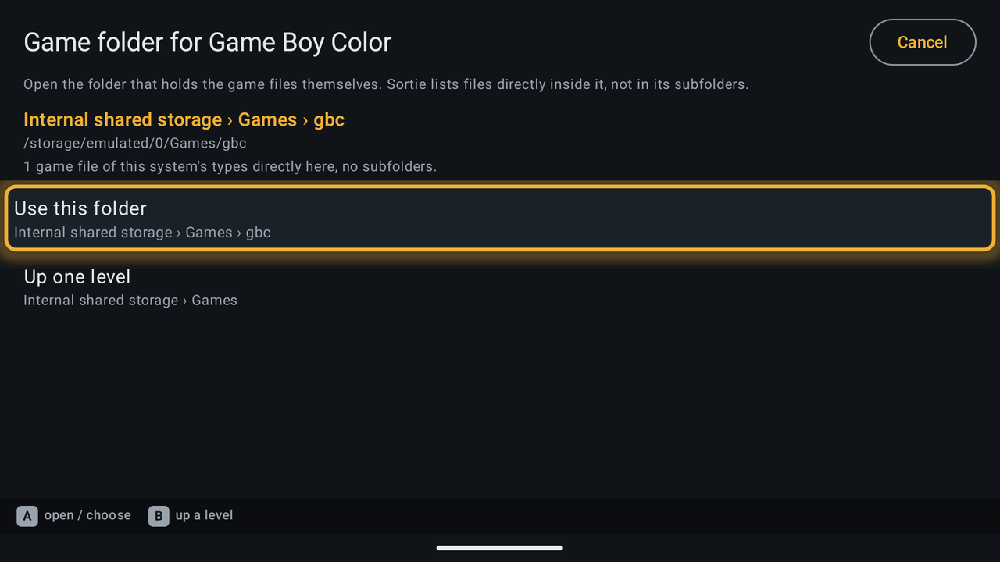

4. **File types** is already filled in (for Game Boy Color: `gbc, zip, 7z`). Leave it unless you know your files use a
   different ending. Empty means every file in the folder is listed. If you change it, **Use the suggested file types**
   puts the suggestion back.

5. **Emulators** is a numbered fallback list. Sortie tries it in order, skipping entries marked *not installed*, so you
   do not need to remove those. Select an entry to **Move up (try earlier)**, **Move down (try later)** or
   **Remove from this system**. **Add an emulator…** adds another one Sortie knows, including **Open with…**
   (Android asks you which app to use, every time; it can offer apps that cannot play games).

   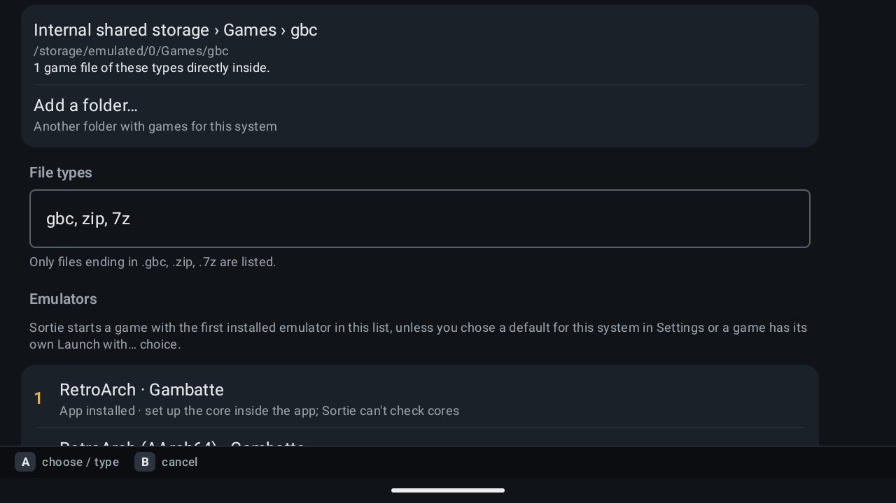

6. Read **Before the first game**. It lists what the emulator still needs (a RetroArch core, BIOS, a first-run setup) and
   which launch methods were actually tested on a device and which were only checked against the emulator's source code.

7. Press **Save**. Sortie shows *Saving…* and *Indexing…*, then a summary such as *Saved Game Boy Color* and *1 game
   indexed for this system*, followed by **Try a launch** with a few of your games.

**Checkpoint:** the result shows at least one game. If it says **No games were indexed for this system**, read the lines
under it: usually the games are in a subfolder, or their file ending is not in **File types**. Open the system again to fix
it; your other settings stay as they are.

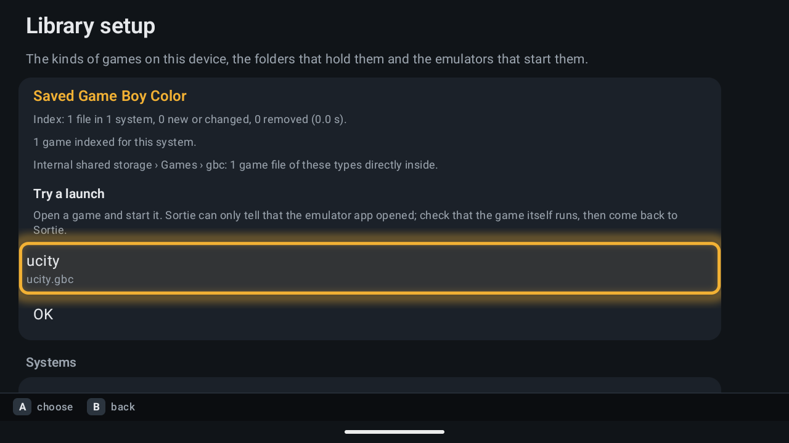

You can leave Library setup while it saves or indexes; the work carries on. Repeat **Add a system…** for each kind of game.

## Launch, play and come back

1. Under **Try a launch**, choose a game. Its page opens with **Play**, **Launch with…**, **Add notes**, **Reference
   cards**, a ☆ favourite button and **+ Want to play**.

   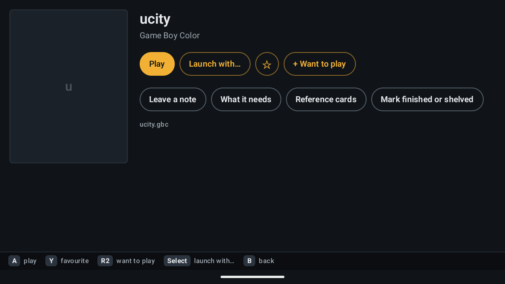

2. Choose **Play** (or press **A**). The emulator opens the game.
3. **Check that the game itself is running.** Sortie can only tell that the emulator app opened, not whether the game
   booted.

   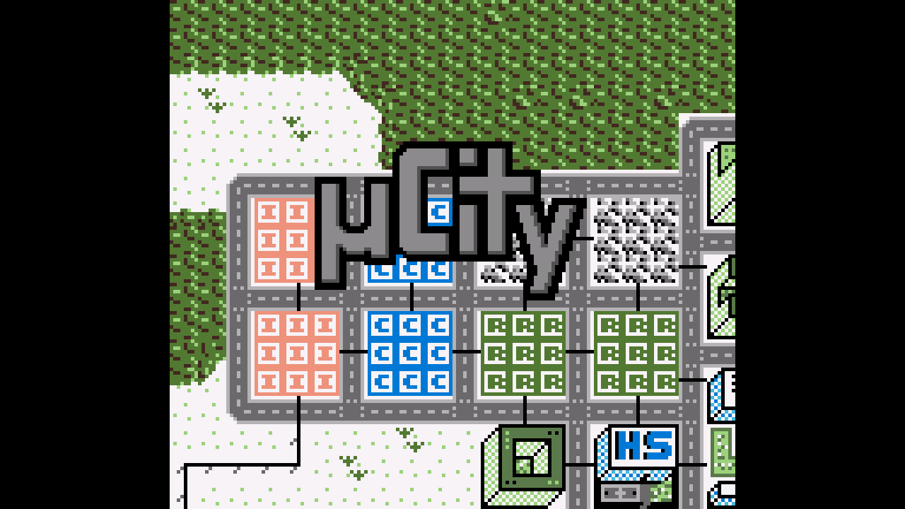

4. **Come back:** quit or leave the emulator as you normally would (for RetroArch, save your game, then use its menu).
   - If Sortie is **not** your Home app, the Home button goes to your usual launcher. Open Sortie again from the app
     drawer or the recent-apps view.
   - If Sortie **is** your Home app, the Home button returns to Sortie (or opens its optional app switcher).

   Sortie never force-closes a game when you switch away. Play time is recorded once the game's window is gone.

**Checkpoint:** back in Sortie, Home now shows your system. On the **Custom** sort a **Continue** tile points at the game you
just played.

**RetroArch notes.** After downloading cores inside RetroArch, quit it before starting a game from Sortie. Save before
changing games. RetroArch 1.22 closes itself when asked to open a *different* game while it runs; Sortie then says so on
the game's page (*RetroArch closed while switching cores — press Play again*). Press **Play** again.

**Which emulator starts a game?** Sortie checks three places, in this order: a per-game choice made with **Launch with…**
on the game's page; the system's choice under **Settings → Default launcher per system**; otherwise the system's
**Emulators** list in Library setup, in order, skipping entries that aren't installed. A Settings choice therefore wins over
reordering in Library setup; pick **Manifest default** there to go back to the list order.

**Your first library will look plain.** Without extra files, games appear with tidied-up file names (`ucity` in this
example), no box art, no descriptions and no ratings. That is expected: Sortie has no internet access and does not fetch
any of these.

### Want box art?

Sortie never downloads artwork, but it reads what these leave behind:

- **Coming from Cocoon:** [Import from Cocoon](#coming-from-cocoon) copies the art Cocoon downloaded. Nothing else needed.
- **On the device, without a computer:** [ES-DE](https://es-de.org/) (a paid Android frontend) has a built-in scraper
  that writes gamelists and media in the exact layout Sortie reads. Run its scraper once, then link each system's
  `gamelist` and `media` folders in `systems.json` ([systems.md](formats/systems.md)). ES-DE keeps them in its `ES-DE`
  folder on internal storage by default. Paths in `systems.json` are relative to Sortie's library location, so if your
  `sortie` folder is on a memory card, write the full path instead, for example for PlayStation 2:

  ```json
  "gamelist": "/storage/emulated/0/ES-DE/gamelists/ps2/gamelist.xml",
  "media": "/storage/emulated/0/ES-DE/downloaded_media/ps2"
  ```

  Full paths work wherever your library lives. Sortie has no on-device setting for these folders yet, so this step is a
  one-off JSON edit, for example in a text editor app.
- **On a computer:** [Skyscraper](https://gemba.github.io/skyscraper/) or ES-DE's desktop version produce the same files;
  copy them to the card and link them the same way. Everything else under [Going further](#going-further) (guides, smart
  folders, logos) is also made this way.

## Finding your way around

| | Controller | Touch |
|---|---|---|
| Open / choose | **A** | tap |
| Back | **B** | Android's Back gesture or button |
| Options for a game, app or system (favourite, add to home, launch with…) | hold **A** | long-press |
| Previous / next system, or Home sort | **L1 / R1** | tap the sort chips |
| Favourite | hold **R1** (on a game page: **Y**) | ☆ on the game page |
| *Want to play* queue | **R2** | **+ Want to play** on the game page |
| List ↔ grid | **Select** | — |
| Search (on Home) | **Y** | **Search** |
| Switch which screen has the controller (two screens) | **X** | — (touch works directly on either screen) |

Home has five sorts. **Alphabetical**, **Game count** and **Generation** show your systems. **Custom** holds **Continue**,
**Apps**, built-in shelves such as **Favourites** and **Want to play**, plus anything you *Add to home*. **By Console** shows
one console's games at a time. The header has **Apps**, **Library setup**, **Search**, **Magazines**, **Journal**, a
book button (manual) and **Settings**. The manual covers every screen in detail.

**To make Sortie your Home screen (optional):** **Settings → Default home app** opens Android's chooser (the entry appears
once you have at least one system). Choose Sortie. **To undo it**, use the same entry and pick your previous launcher. If
Sortie ever gets in the way, swipe down from the top of the screen, open Android's Settings (the gear icon) and go to
**Apps → Default apps → Home app**; the exact path differs slightly by device. You never need to uninstall Sortie to leave
it.

## Optional features and what they need

The first row is the baseline, using the game and emulator prerequisites above. The remaining rows are optional:
enable only the extras you want. No Shizuku, Home role, overlay permission or second screen is needed for the first-game path.

| Feature | What it needs | Where to set it up |
|---|---|---|
| **Browse, set up, launch, search, favourites, Want to play, Finished/Shelved, notes, reference cards, journal, backup** | All files access only | Built in |
| **BIOS missing** hint on a system tile | A BIOS folder chosen in Sortie; only for systems whose preset lists BIOS files (for example Atari Lynx, Sega CD, PC Engine CD, Neo Geo CD, Famicom Disk System, Amiga) | **Library setup → BIOS and save folders** |
| **Started** filter (games with saves, marked with a disk icon) | The emulators' save folders chosen in Sortie | **Library setup → BIOS and save folders** |
| **Sortie as Home screen**: Home button returns to Sortie | Default Home app role | **Settings → Default home app** |
| **Launcher shortcuts** from other apps (**Apps → Browse all shortcuts…**, accepting "add to home" requests) | Default Home app role | **Apps** screen |
| **Companion on a second screen** (art and notes of the focused game, *Now playing*, dock, **+** app starter) | A device with a second display | Automatic while Sortie is open. With the Home role, the second screen also falls back to the companion when it is empty |
| **X screen swap** | A second display | Built in |
| **Switcher**: list running apps, bring one to front, move it to the other screen, close it | **Shizuku** installed, running and allowing Sortie | Shizuku's own app, then **Settings → Diagnostics → Allow Sortie in Shizuku** |
| **Home key opens the switcher** | Default Home app role **and** Shizuku | Both of the above |
| **Switcher drawn over a running game** | Shizuku, plus *Display over other apps* | **Settings → Overlay over running games (optional)** |
| **Companion bell** (opens the notification shade) | Shizuku | — |
| **Radial keyboard** for typing with the sticks | Enabling it as an Android keyboard | **Settings → Enable radial keyboard…**, then **Choose keyboard…** |
| **Box art, screenshots, game descriptions** | ES-DE-style `gamelist.xml` and media folders on storage, linked by hand in `systems.json`; or artwork copied by **Import from Cocoon** | Prepared files: [systems.md](formats/systems.md), or [Coming from Cocoon](#coming-from-cocoon) |
| **Fit stars, hooks, cautions, tags, control notes** | A `guide.json` file | Prepared file: [guide.md](formats/guide.md) |
| **Smart folders** (rule-based shelves such as "added this month, never played") | A `folders.json` file | Prepared file: [folders.md](formats/folders.md) |
| **System logos** on Home tiles | PNG files in `sortie/logos/` | Prepared files: [formats](formats/README.md) |
| **Magazines** | Included in the signed releases; extra issue packs can be copied into `sortie/magazines/` | **Home → Magazines** or **Apps → Magazines**; opens as its own app on either screen; packs: [formats](formats/README.md#magazine-packs-version-2) |
| **Performance app** | No extra permission to open; Shizuku supplies additional hardware readings | **Apps → Performance**, or **Open app…** on the chosen screen; B/Close closes only this window |
| **Custom emulators** not in Sortie's list | A launch profile in `launchers.json` | Prepared file: [launchers.md](formats/launchers.md), [LAUNCHERS.md](LAUNCHERS.md) |

**Shizuku in brief.** Shizuku is a separate app with its own setup guide at [shizuku.rikka.app](https://shizuku.rikka.app/).
On a device without root it is started through Android's *Wireless debugging* (Sortie's **Settings → Diagnostics → Wireless
debugging** opens that page) and usually has to be started again after every reboot. If you skip it, everything except the
switcher, moving other apps between screens and the bell still works. **X** still swaps Sortie's own screens without it.

**"Prepared files" means exactly that.** Apart from what [Import from Cocoon](#coming-from-cocoon) brings over (artwork,
and folders from a Cocoon backup), there is no in-app editor or download for artwork, guides, smart folders, logos or
custom emulators. Tools such as ES-DE's scraper or Skyscraper make the artwork files ([Want box art?](#want-box-art));
guides, smart folders, logos and launch profiles are written by hand or by your own scripts. Copy them into the `sortie`
folder or point Sortie at them. Library setup leaves such files and fields alone when you change a system, so a prepared
library and on-device setup can be used together.

## How Sortie thinks

**A personal, offline library, not a game store.** Sortie shows what is on *your* storage and starts it with *your*
emulators. It never downloads games, BIOS, emulators, cores, artwork or descriptions. An installed emulator does not prove
that its core, BIOS or a particular game is ready; only playing the game proves that.

**Launcher, not emulator.** Controls, graphics, save states and compatibility are the emulator's business, set inside the
emulator. Sortie decides *which* emulator to start and remembers what you did.

**Opinionated by design.** Sortie is built around a controller, a handheld (especially dual-screen handhelds such as the
AYN Thor), offline use and plain files you own. It does not try to be an all-in-one frontend. Some features assume
prepared files rather than in-app wizards.

**Systems and smart folders are different things.** A *system* is set up in Library setup: one kind of game, its folders
and its emulators. Every game belongs to exactly one system. A *smart folder* is a shelf defined by rules (tags, fit, play
time, how long since you played…) in a prepared `folders.json`; a game can appear in many. **Favourites**, **Want to play**,
**Finished** and **Shelved** are built-in shelves you fill yourself, no files needed.

**Editorial fit versus your verdict.** *Fit* stars, hooks and cautions come from a guide someone wrote (`guide.json`).
They describe how well a game suits that guide's taste, not a review score or a compatibility promise. Your own notes,
*Where was I?*, *What it needs*, and Finished/Shelved verdicts are yours and never change the guide.

**Game references versus local files.** Magazines and articles talk about games whether or not you have them. *Games
mentioned* lists games linked by an issue's editors; **On this device** filters to ones found in your library.
Choosing a mention opens a game page or the article, never starts a game. A local match means a readable file is available,
not that it will run.

**Optional content is optional.** A Sortie build may come with magazine issues or with an empty shelf; the default build
has none. Guides, artwork and smart folders exist only if someone prepared them for your library. A missing optional file
just leaves that part empty.

**Your state and shared content are kept apart.** Your favourites, queue, shelves, notes, reference cards, journal and
play history are yours (`user.json` and Sortie's own database; export them with **Backup and restore**). Shared content
such as guides, magazines and logos is read, never rewritten with your personal data. A Cocoon library can be
[imported](#coming-from-cocoon) without changing Cocoon's files; other launchers are not imported. Your game files can
stay where they are and be used by several apps at once.

## Troubleshooting

**"Can't start *game*: its file isn't on this device right now."** The memory card or folder is missing. Reinsert it, then
**Library setup → Re-index every system**.

**"Can't start *game*: no emulator is set up for *system* yet."** Open the system in **Library setup** (also under
**Settings → Library and emulators**) and use **Add an emulator…**.

**"Can't start *game*: *emulator* isn't installed."** Install that emulator, or add or move up another one in the system's
**Emulators** list. Sortie checks again when you return to the screen. You can also choose a different emulator for one
game with **Launch with…** on its page, or for a whole system in **Settings → Default launcher per system**.

**"… didn't accept the game."** The installed emulator version may not match Sortie's launch method. Try another emulator
for the game with **Launch with…**. **Settings → Diagnostics** keeps the exact launch attempts if you need to report it.

**The emulator opens, but shows its own menu, an error or a black screen.** That is the emulator's side: a missing
RetroArch core, missing BIOS, an unfinished first-run setup, missing storage permission for the emulator, or a game file it
cannot read. Go back to [Set up and test one emulator](#set-up-and-test-one-emulator) and make the game run inside the
emulator first. For PSP homebrew, start loose `.elf`/`.prx` files and `EBOOT.PBP` folders inside PPSSPP; disc images
work from Sortie.

**A BIOS file is missing.** Sortie never supplies BIOS files. Install the BIOS in the emulator as its documentation says.
Sortie's own **BIOS folder** setting only shows a *BIOS missing* hint for a few systems; it does not configure emulators.

**Games I copied don't show up.** Sortie does not watch your folders. Use **Library setup → Re-index every system**. Also
check that the files sit directly in a chosen folder (not a subfolder) and end in one of the system's **File types**. Two
files with the same name in different folders of one system appear as one game.

**I removed the memory card.** Sortie keeps its list of games and does not start a new library elsewhere; systems and
games on that card may be missing until it is back. Reinsert the card, re-index, and if Library setup offers **Try again**,
choose it. **Do not set up the library again on other storage**: your notes and preferences are in the original `sortie`
folder (shown under **Library setup → Where these settings live**).

**Library setup says a settings file can't be used, or that settings changed on the card.** Sortie will not overwrite a
file it cannot read or one that changed while you were editing. Use **Reload library settings** (your draft is kept), or
fix or move the named file after making a copy.

**Android settings opened the wrong page.** Sortie shows the path to use instead, for example **Settings → Apps → Special
app access → All files access → Sortie**.

**I want my old Home screen back.** See [Finding your way around](#finding-your-way-around): change the default Home app;
never uninstall Sortie for this.

**Android refuses to update Sortie.** See [Updating safely](#updating-safely). Do not uninstall.

**Careful with hiding games.** **Hide this game from folders** (under **Launch with…** on a game page) and the import's
**Hide *N* games** switch keep games out of folders and shelves. There is currently no button to undo it inside Sortie;
undoing it means editing the `hidden` list in `user.json` ([user.md](formats/user.md)).

**Import from Cocoon doesn't list my Cocoon folder.** Sortie only offers folders whose gamelists carry Cocoon's own tags,
so an ES-DE folder isn't offered. Type the folder's path (for example `/storage/emulated/0/Cocoon`) or pick it with the
file browser.

**A system imported from Cocoon shows no games.** New systems include supported file types found in the matched games,
including archives. Existing systems keep their file-type settings: check **Library setup → File types**. To avoid duplicate
disc tracks, new track extensions are not added automatically when the same system has cue sheets or playlists; the preview
reports those skipped matches. Games listed as *not found* or *ambiguous* were skipped; add their folders in Library setup.

**An older import changed a system's emulator.** Current imports leave existing defaults alone. To undo a default saved by
an older build, use **Settings → Default launcher per system → Manifest default** to restore the order from Library setup.
For one game's choice, use **Launch with…** on its game page.

## Going further

- **The [manual](../app/src/main/assets/MANUAL.md)** (also built in): every screen, the companion, the switcher, magazines,
  reference cards, the journal, backups and the radial keyboard.
- **Backups:** **Settings → Backup and restore → Export backup…** saves your personal data to a file. To keep your library
  setup as well, copy the whole `sortie` folder.
- **Artwork and descriptions** from ES-DE-style gamelists and media folders: [systems.json](formats/systems.md) and
  [device.json](formats/device.md).
- **Guides, smart folders, launch profiles and every other file:** [docs/formats/](formats/README.md), with a complete
  minimal example in [examples/card/](../examples/card/).
- **Which emulators and versions were actually tested:** [LAUNCHERS.md](LAUNCHERS.md). Other presets are labelled in the
  app as checked against the emulator's source only. Nothing here promises that every emulator or game works.
- **Releases, signing and beta status:** [RELEASE.md](RELEASE.md).
